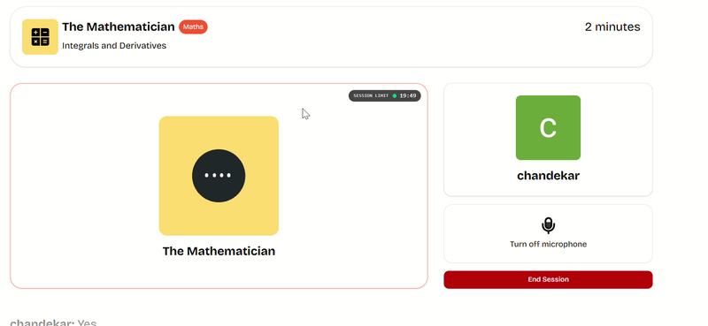
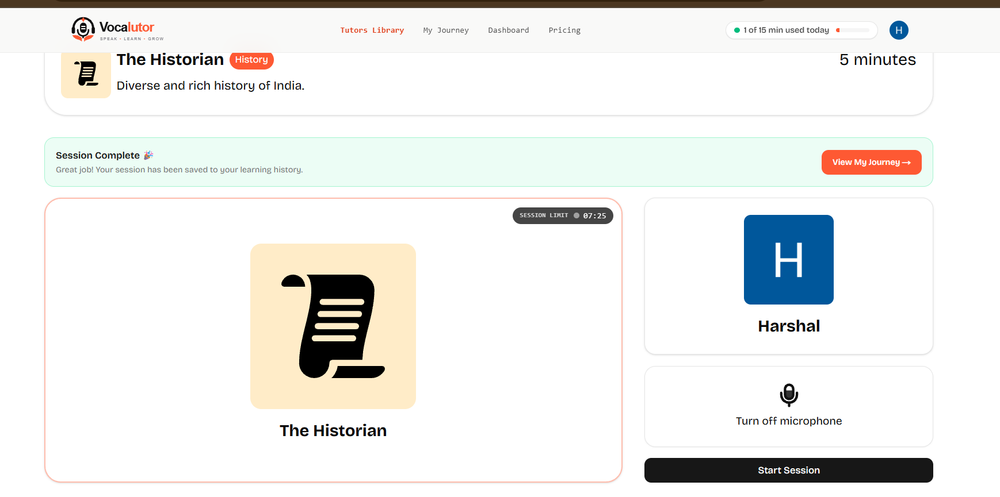
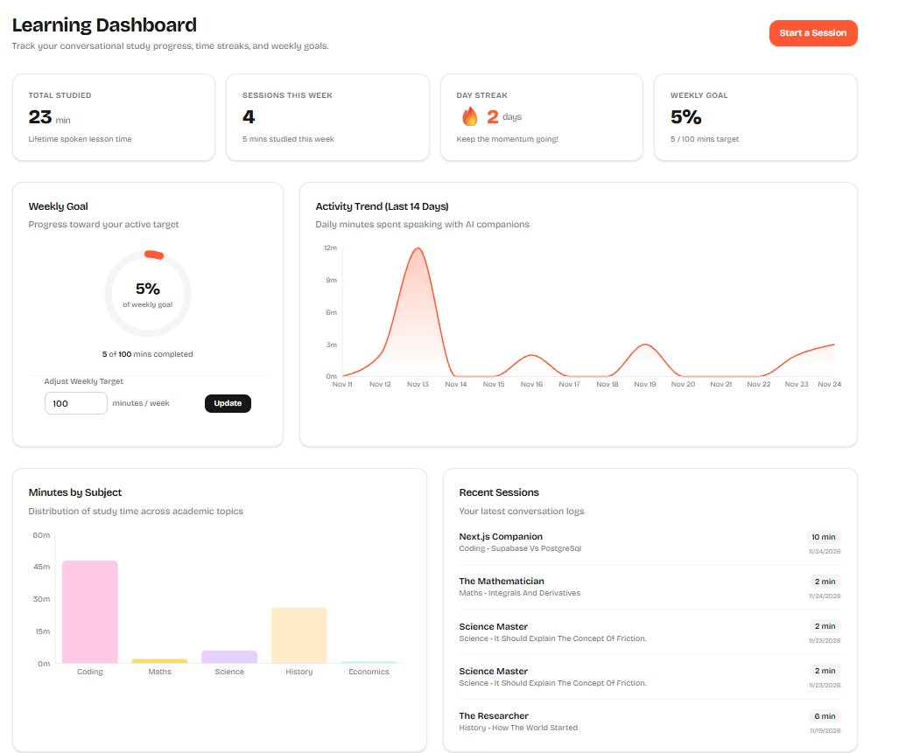
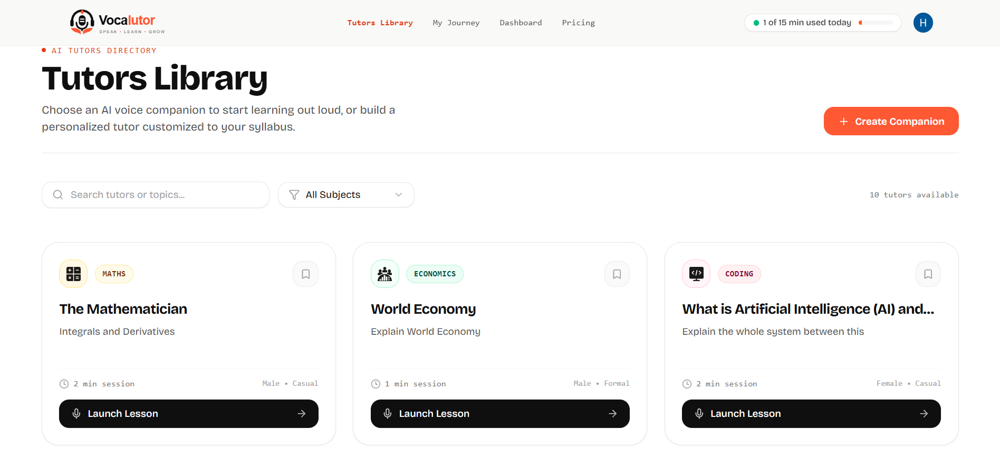
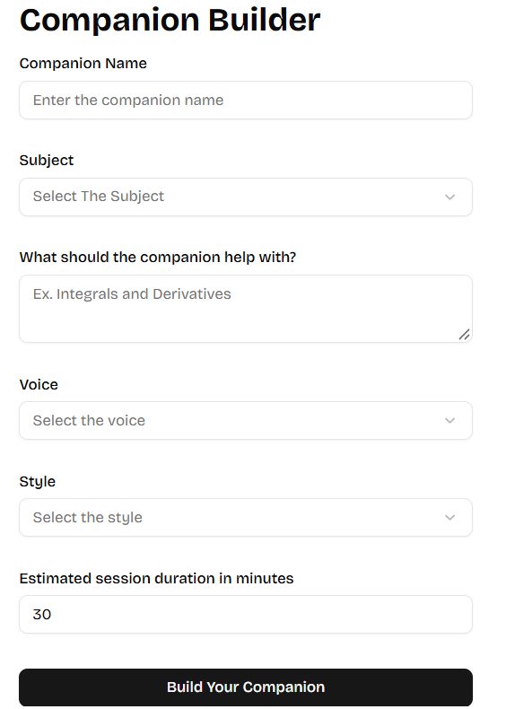

<p align="center">
  
</p>

<h1 align="center">Vocalutor — Voice-Interactive AI Tutoring SaaS</h1>

<p align="center">
  <strong>Talk to an AI tutor out loud. Pick a subject, start a voice session, and learn by conversation instead of reading.</strong>
</p>

<p align="center">
  <a href="https://nextjs.org/"></a>
  <a href="https://react.dev/"></a>
  <a href="https://www.typescriptlang.org/"></a>
  <a href="https://tailwindcss.com/"></a>
  <a href="https://vapi.ai/"></a>
  <a href="https://supabase.com/"></a>
  <a href="https://clerk.com/"></a>
  <a href="https://vitest.dev/"></a>
</p>

---

> 💡 **Project Origins:**  
> *Vocalutor started its journey inspired by a YouTube tutorial, but was re-architected, hardened, and expanded into a production-grade, secure, full-stack SaaS application with enterprise security, daily study streaks, WebRTC voice streaming, and robust quota governance.*

---

## 📸 Visual Showcase & Demo

<!-- Tip: Replace these paths with your recorded demo GIF or screen captures (e.g. assets/demo.gif) -->

### 🎥 Live Voice Interaction Demo

<div>
<p align="center">
  
</p>


<div align="center">
  <table>
    <tr>
      <td width="50%">
        <h4 align="center">🎙️ Interactive Voice Room</h4>
        <p align="center"><em>Real-time WebRTC audio with animated soundwaves & quota timer</em></p>
        
        <p align="center"></p>
      </td>
      <td width="50%">
        <h4 align="center">📊 Learning Analytics Dashboard</h4>
        <p align="center"><em>Timezone-aware streaks, activity trends, and weekly goals</em></p>
        
        <p align="center"></p>
      </td>
    </tr>
    <tr>
      <td width="50%">
        <h4 align="center">📚 Tutors Library</h4>
        <p align="center"><em>Instant subject filtering, search, and personal bookmarks</em></p>
        
        <p align="center"></p>
      </td>
      <td width="50%">
        <h4 align="center">🛠️ Custom Companion Creator</h4>
        <p align="center"><em>Configurable voice styles, subjects, and tiered creation limits</em></p>
        
        <p align="center"></p>
      </td>
    </tr>
  </table>
</div>

---

## ❓ The Problem Vocalutor Solves

Most online learning platforms are fundamentally **passive**:
- Watching hours of video lectures produces the **"illusion of competence"** — you feel like you understand while watching, but struggle when asked to explain or apply concepts.
- Text-based AI chatbots require typing back and forth, losing the natural flow, urgency, and engagement of real human tutoring.
- Private 1-on-1 human tutors cost $40–$100/hour, making continuous spoken practice inaccessible for most students.

**How Vocalutor fixes this:**
- **Active Recall Out Loud:** You speak directly with the AI tutor. It asks probing Socratic questions, listens to your reasoning, interrupts gently if you're stuck, and clarifies misunderstandings instantly.
- **Low-Latency Conversational Flow:** Sub-500ms voice pipeline makes talking feel immediate and fluid, exactly like a phone call with a knowledgeable mentor.
- **Accessible & Gamified:** Practice anytime, anywhere with daily streaks, study goal progress, and generous daily allowances.

---

## ✨ Core Features

- 🎙️ **Real-Time Bidirectional Voice Sessions:**
  - Integrated with **Vapi AI Web SDK** (`@vapi-ai/web@3.1.0`) and **Daily.js** (`@daily-co/daily-js@0.95.0`).
  - Ultra-fast transcription via **Deepgram Nova-3**, reasoning by **OpenAI GPT-4**, and lifelike speech synthesis by **ElevenLabs**.
  - Interactive speech waves powered by dynamic **Lottie** animations.

- ⏱️ **Voice-Minute Guardrails & Quota Engine:**
  - Enforces daily spoken limits (Free: 15 min/day, Pro: 60 min/day).
  - Dual enforcement: client-side visual countdown timers plus hard server-side telephony disconnects (`maxDurationSeconds`).
  - Rolling usage tracking via `voice_usage` PostgreSQL logs.

- 📈 **Learning Dashboard & Daily Study Streaks:**
  - Timezone-aware streak tracking algorithm (`computeStreak`) that accounts for user local midnight boundaries.
  - 14-day study history area chart and subject breakdown bar chart powered by **Recharts**.
  - Customizable weekly study goals with dynamic progress rings.

- 🧑‍🏫 **Personalized AI Tutors Library:**
  - Search and filter tutors across Mathematics, Science, Coding, History, Economics, and Language.
  - Create custom companions with configurable voice personality (formal vs. casual) and gender.
  - Personal bookmarking and session history tracking under "My Journey".

- 🛡️ **Production-Grade Security Architecture:**
  - **Zero-Bypass Server Actions:** Every action verifies Clerk authentication (`auth().userId`) and checks subscription quotas.
  - **PostgreSQL Row-Level Security (RLS):** Clerk JWT tokens passed directly to Supabase (`auth.jwt() ->> 'sub' = user_id`) for database-level tenant isolation.
  - **Default-Deny Middleware:** Unprotected routes are blocked by default using Clerk's `createRouteMatcher`.
  - **Fail-Fast Environment Validation:** Startup module (`lib/env.ts`) guarantees all critical keys are present before runtime.

- 🧪 **Full Test Coverage:**
  - 21 unit tests running via **Vitest** testing quota boundaries, fractional usage, and multi-timezone streak math.

---

## 🧠 What I Learned Building This

Building Vocalutor beyond a standard tutorial required tackling real-world production engineering challenges:

1. **WebRTC Voice Orchestration:** Handling live microphone permissions, audio streams, echo cancellation, network jitter, and telephony session teardowns reliably across browsers.
2. **Clerk JWT + Supabase RLS Integration:** Bridging third-party auth (Clerk) with Supabase PostgreSQL without relying on Supabase Auth. Solved the common `invalid input syntax for type uuid` trap by utilizing string `(auth.jwt() ->> 'sub')` and configuring proper Postgres RLS policies.
3. **Defensive Next.js 15 Server Actions:** Learning that `'use server'` endpoints can be called directly over HTTP POST. Implemented end-to-end server-side Zod validation, authorization checks, and PostgREST filter injection sanitization.
4. **Timezone-Aware Algorithmic Math:** Building pure functions for daily streak computation that handle international date boundaries and leap years without external date bloat libraries.
5. **Auditing AI-Generated Code:** Conducting an end-to-end OWASP security audit, fixing package CVEs, eliminating false promises from marketing pages, and ensuring zero hardcoded secrets.

---

## 🛠️ Complete Tech Stack

| Layer | Technology | Purpose |
| :--- | :--- | :--- |
| **Framework** | **Next.js 15 (App Router)** | Full-stack architecture, React Server Components, Server Actions. |
| **Frontend** | **React 19 & TypeScript 5** | Strict type-safe UI layer. |
| **Styling** | **Tailwind CSS v4** | Modern utility-first styling with `@tailwindcss/postcss`. |
| **Voice AI Engine** | **Vapi AI Web SDK (`^3.1.0`)** | Live voice streaming pipeline (Deepgram + ElevenLabs + GPT-4). |
| **WebRTC Transport**| **Daily.js (`^0.95.0`)** | Media streaming transport layer. |
| **Auth & Billing** | **Clerk (`^6.27.1`)** | Secure user authentication, Google OAuth, and billing plans. |
| **Database** | **Supabase (`^2.53.0`)** | PostgreSQL with Row-Level Security policies. |
| **Data Viz** | **Recharts** | Dynamic learning analytics charts (`ssr: false`). |
| **Testing** | **Vitest** | Fast unit testing for pure algorithms and quotas. |
| **Error Monitoring**| **Sentry (`^10.0.0`)** | Real-time crash reporting and source-map telemetry. |

---

## 🚀 Getting Started Locally

### 1. Prerequisites
- **Node.js**: `20.x` or higher
- **npm**: `10.x` or higher
- Accounts on **Clerk**, **Supabase**, and **Vapi AI**.

### 2. Clone the Repository
```bash
git clone https://github.com/harshalchandekar/Vocalutor.git
cd Vocalutor
npm install --legacy-peer-deps
```

### 3. Environment Variables
Copy `.env.example` to `.env.local`:
```bash
cp .env.example .env.local
```

Fill in your service keys:
```env
# Clerk Authentication
NEXT_PUBLIC_CLERK_PUBLISHABLE_KEY=pk_test_...
CLERK_SECRET_KEY=sk_test_...
NEXT_PUBLIC_CLERK_SIGN_IN_URL=/sign-in
NEXT_PUBLIC_CLERK_SIGN_UP_URL=/sign-up
NEXT_PUBLIC_CLERK_SIGN_IN_FALLBACK_REDIRECT_URL=/companions
NEXT_PUBLIC_CLERK_SIGN_UP_FALLBACK_REDIRECT_URL=/companions

# Supabase Database
NEXT_PUBLIC_SUPABASE_URL=https://your-project.supabase.co
NEXT_PUBLIC_SUPABASE_ANON_KEY=eyJhbGciOi...

# Vapi Voice Web Token
NEXT_PUBLIC_VAPI_WEB_TOKEN=your-vapi-public-token
```

### 4. Database Setup
Run the SQL migration scripts in your **Supabase Dashboard → SQL Editor**:
1. `supabase/migrations/001_dashboard_tables.sql` (Creates `user_settings` and `voice_usage` tables).
2. `supabase/migrations/20261124190000_core_tables_rls.sql` (Enables Clerk Row-Level Security on all core tables).

### 5. Run & Test
```bash
# Start local development server
npm run dev

# Run unit tests
npm test

# Run ESLint check
npm run lint

# Run production build
npm run build
```

Visit [http://localhost:3000](http://localhost:3000) to start learning out loud!

---

## 📄 License
This project is open-source and available under the [MIT License](LICENSE).
